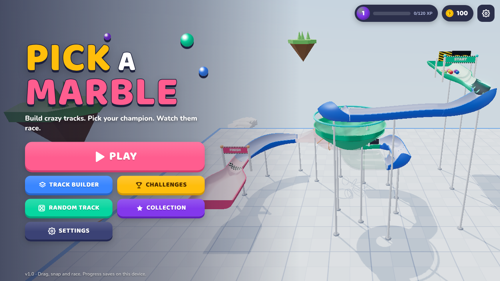
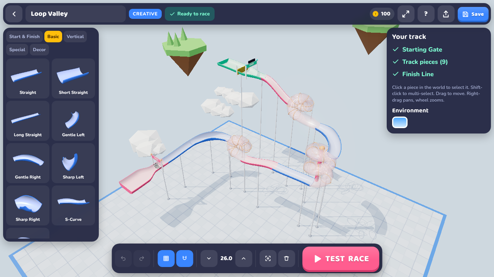
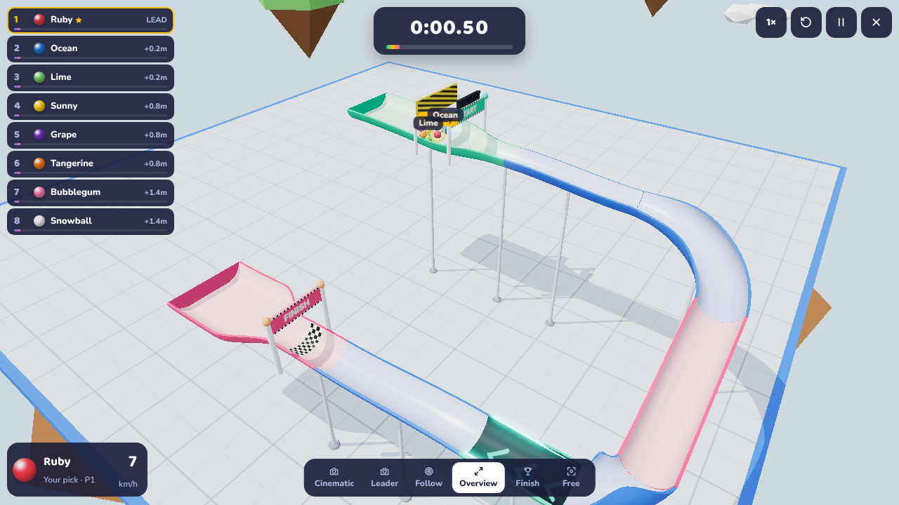
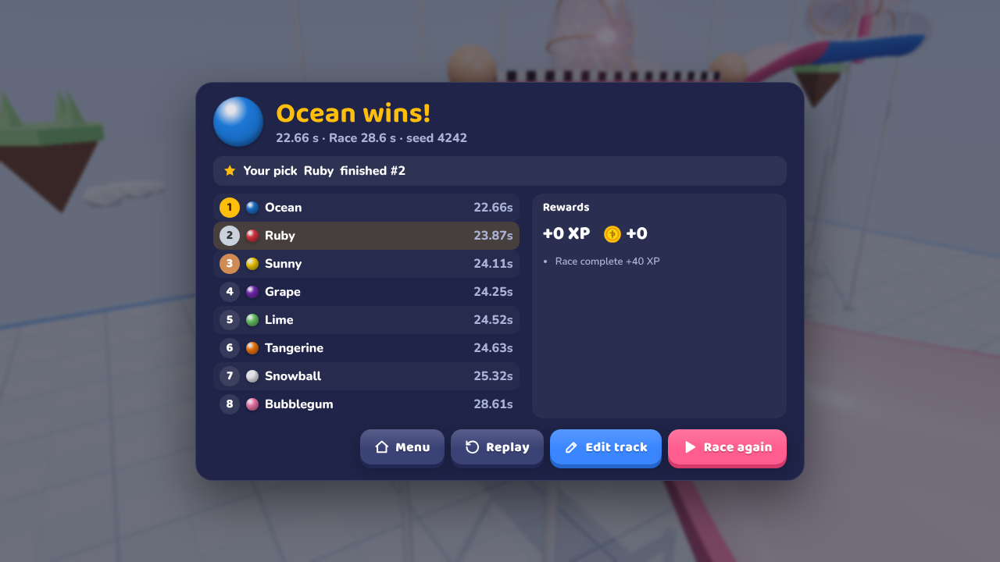

# Pick a Marble

Build crazy marble tracks, pick your champion, and watch physics-driven races.
A 3D browser game made with Three.js, Rapier and TypeScript, prepared for CrazyGames.



| Track builder | Race overview | Results |
| --- | --- | --- |
|  |  |  |

Full race sequence (countdown → gate → jumps → bounce pad → cannon → finish):
[docs/screenshots/race-sequence.png](docs/screenshots/race-sequence.png)

## Quick start

```bash
npm install
npm run dev        # http://127.0.0.1:5188
npm run build      # production build in dist/
npm run preview    # serve the production build on http://127.0.0.1:4188
npm run build:single # one self-contained pick-a-marble.html (double-click to play, no server)
```

Requires Node 18+ (developed on Node 22). The production build is a static folder
(`dist/`) with relative asset paths, so it can be zipped and uploaded to CrazyGames
or any static host as-is.

## Testing

```bash
npm run test:sim       # headless physics scenarios (Node, no browser)
npm run test:builtins  # validate + race every built-in track
npm run test:gen       # random-track generator: generate + race-verify tracks
npm test               # Playwright browser tests (desktop + mobile)
npm run inspect:canvas # canvas pixel inspector (see scripts/inspect-threejs-canvas.mjs)
npx tsx tests/sim/qa.ts # QA checklist: determinism, restarts, invalid connections, save/load, long races
```

If Playwright's bundled browser revision is not installed, point the tests at any local
Chromium with `PW_CHROMIUM_PATH=/path/to/chrome npm test`.

`tests/sim/run-sim.ts` races 12 marbles over straights, curves, ramps, loops,
funnels, moving obstacles, jumps, splitters and vertical pieces and prints how many
finish, how many fell, and where marbles needed recovery.

## How to play

1. **PLAY** – race on featured tracks or your saved ones, or hit *Quick Race*.
2. **TRACK BUILDER** – place a Starting Gate, chain pieces onto the green exit
   arrows (they snap automatically), end with a Finish Line, press **TEST RACE**.
3. **PICK YOUR MARBLE** – choose 2–12 marbles, their skins, names and start order,
   and star your favourite. If it wins you earn bonus coins.
4. **CHALLENGES** – 12 handcrafted goals (piece limits, loops, jumps, multiple
   routes, time limits…) that reward coins and exclusive marbles.
5. **RANDOM TRACK** – procedurally generated tracks (easy/medium/hard). Every
   generated track is test-raced by the physics engine before you see it.
6. **COLLECTION** – unlock marble skins, track components and environments.

### Builder controls

| Action | Mouse / keys | Touch |
| --- | --- | --- |
| Orbit / pan / zoom | left-drag empty space / right-drag / wheel | 1 finger / 2-finger pan / pinch |
| Place a piece | click a library card, then click the world (or drag the card onto the world) | tap card, tap world to position, **Place** |
| Select / multi-select | click / shift-click | tap |
| Move | drag a selected piece | drag |
| Rotate / mirror | `R` / `M` | buttons in the side panel |
| Raise / lower | `Q` / `E` (shift = ×4) | arrows in the bottom bar |
| Undo / redo | `Ctrl+Z` / `Ctrl+Y` | bottom bar |
| Copy / paste / duplicate | `Ctrl+C` / `Ctrl+V` / `Ctrl+D` (duplicate chains onto the exit) | side panel |
| Group / ungroup | `Ctrl+G` / `Ctrl+Shift+G` | side panel |
| Grid snap / free placement | `G` / magnet button | bottom bar |
| Test race | `Space` | **TEST RACE** |

Race: `1`–`6` switch cameras (cinematic, leader, follow, overview, finish, free),
`Esc` pauses, `R` restarts; click a marble in the standings to follow it.

## Online rooms

Menu → **ONLINE**: create a private room (5-letter code + invite link) or join one.
Up to 12 players; each owns one marble (their chosen skin and name), empty slots
are bots. The host picks the track (featured, random or their saved tracks) and
the number of marbles; points per round: 10/7/5/3/2/1.

- Networking is browser-to-browser WebRTC via [PeerJS](https://peerjs.com/), no
  game server. Signalling uses the free public PeerJS broker; override with
  `?peerhost=…&peerport=…&peerpath=…&peersecure=0` (a local broker:
  `node tests/online/peer-server.cjs 9000`).
- The host simulates the race and streams snapshots 10×/s; guests simulate locally
  and re-align, and the host's finish order is the official result.
- On CrazyGames the room code travels through the SDK invite link and Instant
  Multiplayer opens a room directly (`src/platform/CrazyGames.ts`).
- Test: `node tests/online/two-players.cjs <shots-dir>` (host + guest browsers).

Illustrated skins (sport balls, animals, food, planets, faces…) are painted per
pixel in sphere space in `src/marbles/ArtSkins.ts`.

## Architecture

```
src/
  core/random.ts            seeded RNG (deterministic races & generator)
  track/
    geometry.ts             profile sweeps, frames, lathe surfaces
    pieceKit.ts             shared builders (channels, tubes, decals, arches)
    catalog.ts              all 40 track components (geometry, colliders, lanes, zones, movers)
    PieceRegistry.ts        build cache + mirrored variants
    Track.ts                track data helpers, transforms, import sanitising
    TrackConnectionSystem   port graph, snapping candidates, grid snap
    TrackValidator.ts       missing start/finish, disconnected, dead ends, mismatches, overlaps
    TrackChain.ts           programmatic placement (built-ins, challenges, generator)
  physics/PhysicsWorld.ts   Rapier world: welded static trimesh, kinematic movers, effect zones
  race/
    RaceSim.ts              headless race rules: start gate, finish, falls/recovery, stuck nudges
    RaceGraph.ts            lane graph → distance-to-finish rankings across branches
    RaceManager.ts          visual race: countdown, events → audio/VFX, results
    CameraManager.ts        cinematic / leader / follow / overview / finish / free cameras
    Effects.ts              pooled particles and confetti
  editor/TrackBuilder.ts    placement, snapping, drag, multi-select, groups, clipboard, validation
  editor/History.ts         snapshot undo/redo
  marbles/                  skins (cosmetic only) and marble rendering
  modes/                    challenges, random generator, built-in tracks
  meta/                     saves (localStorage + JSON import/export), progression, settings
  audio/AudioManager.ts     procedural Web Audio music + SFX
  scene/                    renderer, environments, materials, track rendering, thumbnails
  platform/CrazyGames.ts    optional CrazyGames SDK v3 wrapper
  ui/                       HTML/CSS interface
  game/GameManager.ts       state machine and glue
```

### Physics

Rapier (`@dimforge/rapier3d-compat`) at a fixed 120 Hz step with a clamped
accumulator. Every rolling surface is a cross-section swept along a path; all ports
share the same profile with a horizontal tangent, so the whole track is merged into
**one welded trimesh** with internal-edge fixing — marbles cross piece seams without
bumps. Marbles use CCD, a speed clamp, rolling damping and real marble-to-marble
collisions. Moving obstacles are kinematic bodies driven by deterministic functions
of race time. Boosters, kickers, launch pads and cannons are trigger zones that set
physically plausible velocities. Marbles that fall off are returned to the last
point they were on the track; three falls eliminate a marble. Same seed → same race
(the *Replay* button).

### Track format

Tracks are compact JSON (`TrackData` in `src/track/types.ts`):

```json
{ "v": 1, "id": "…", "name": "My Run", "env": "sky",
  "pieces": [ { "id": 1, "t": "start", "p": [-18, 15, -10], "r": 0 },
              { "id": 2, "t": "loop", "p": [-6, 14.25, -10], "r": 0, "m": 1, "c": "#ff5d8f" } ],
  "meta": { "source": "creative", "area": 32 } }
```

`t` = component id, `p` = position, `r` = quarter turns, `m` = mirrored, `c` =
colour, `g` = group. Saves live in `localStorage` (`pam.tracks.v1`); the
`TrackStore` interface in `src/meta/SaveManager.ts` is the seam for adding online
sharing later.

### CrazyGames

`src/platform/CrazyGames.ts` loads the SDK v3 script only on CrazyGames hosts (or
with `?cg=1`) and calls `loadingStart/Stop`, `gameplayStart/Stop` (editor and
races), `happytime` (wins and completed challenges) and a rate-limited `midgame` ad
only between races — never during one. Audio follows the SDK mute setting and ads
pause the game. No account or backend is required.
