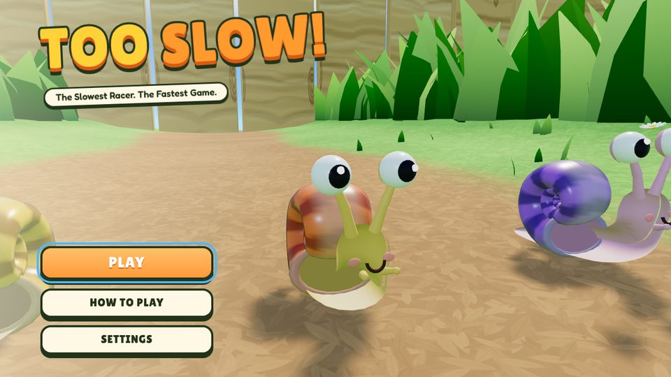
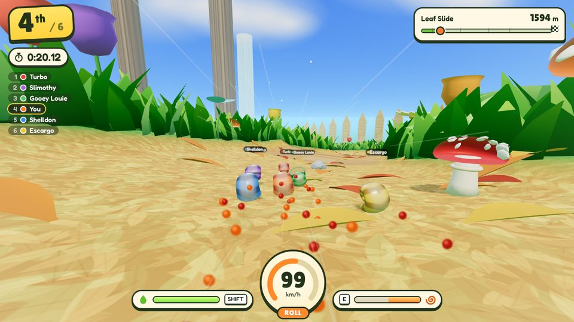
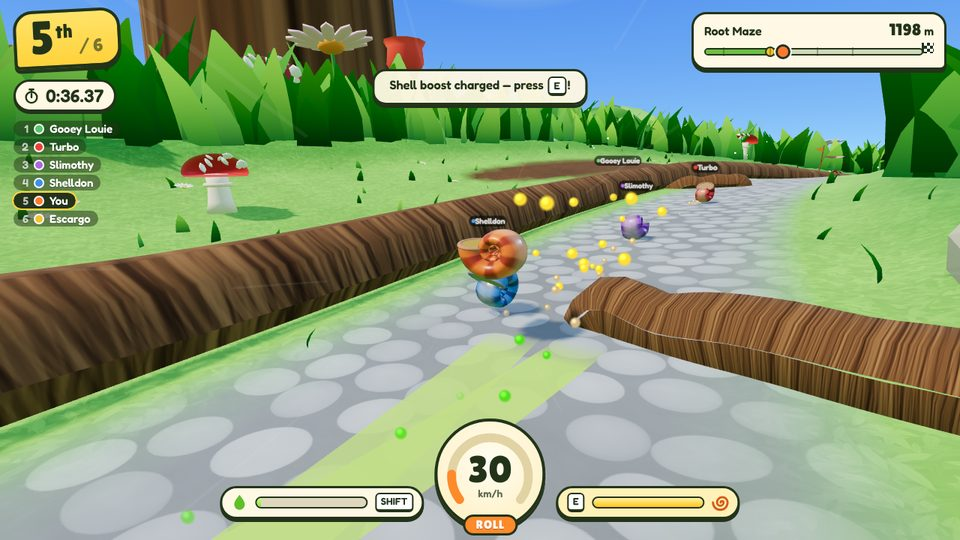
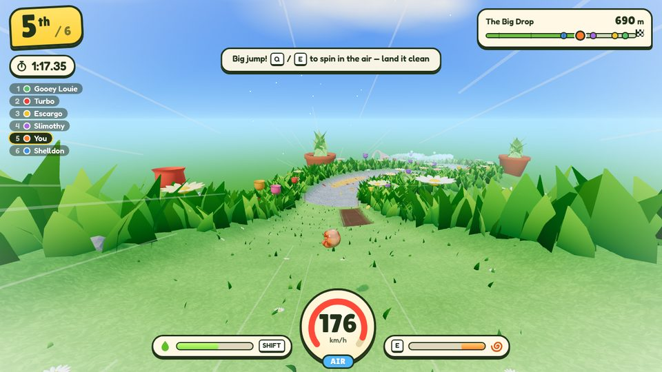
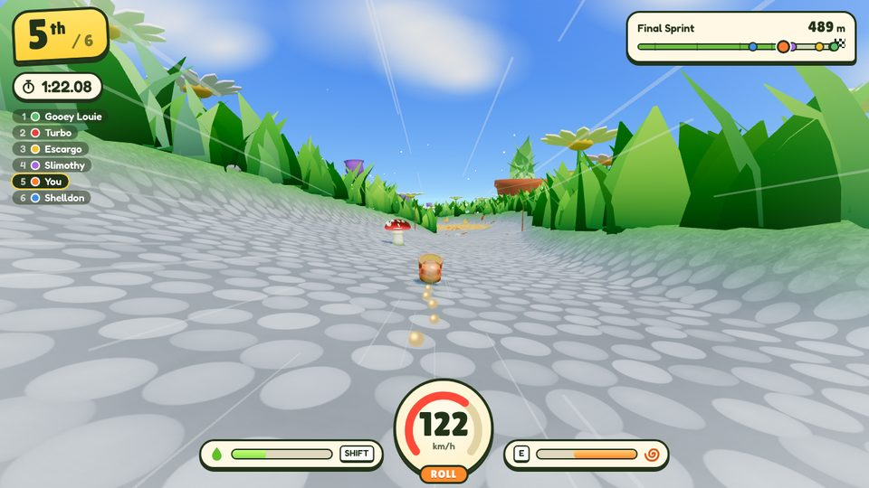
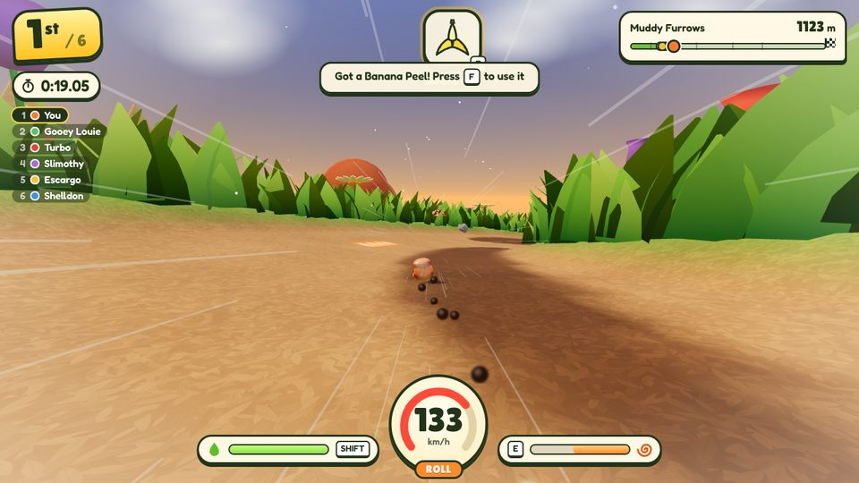
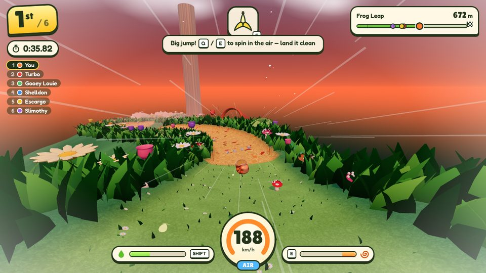
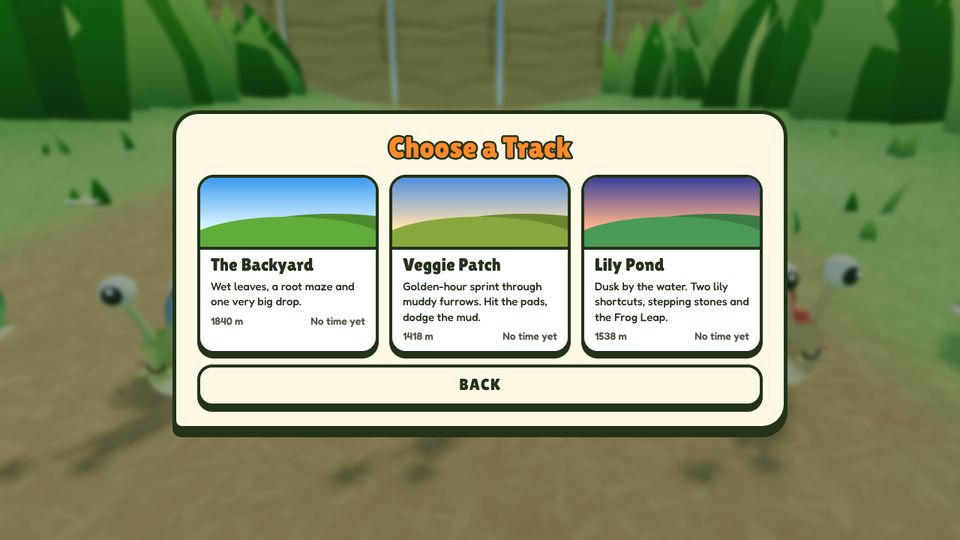
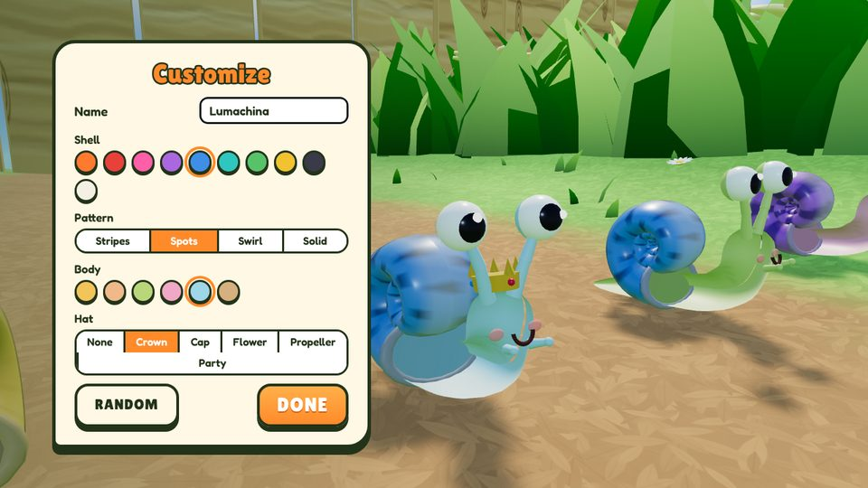

# TOO SLOW!

**The Slowest Racer. The Fastest Game.**

A 3D downhill snail racing game for desktop browsers, built with Three.js, TypeScript and Vite.
You are a snail. You cannot accelerate. Gravity can. Crawl to the edge, tuck into your shell, and
let the hill do the rest — six snails, three point-to-point courses, kart-style item boxes, boost
pads and drift mini-turbos, and a garage to dress up your snail.



| Leaf Slide | Root Maze |
| --- | --- |
|  |  |
| **The Big Drop** | **Final Sprint** |
|  |  |
| **Veggie Patch** | **Lily Pond** |
|  |  |
| **Track select** | **Customize** |
|  |  |

## Run it

```bash
npm install
```

```bash
npm run dev
```

Then open http://127.0.0.1:5188.

Production build (static files in `dist/`, relative asset paths, no server-side code):

```bash
npm run build
```

```bash
npm run preview
```

## Controls

| Key | Crawl | Roll | Air |
| --- | --- | --- | --- |
| `W` | crawl forward | — (no thrust while rolling) | — |
| `S` | slow / reverse | drag the shell to brake | — |
| `A` `D` | turn | steer (wider at speed) | nudge left / right |
| `SPACE` | tuck into shell | pop out (on the ground) | tuck in |
| `SHIFT` (hold) | slime slide | slime slide | — |
| `E` | — | shell boost when charged | spin right |
| `Q` | — | — | spin left |
| `F` | use item | use item | use item |
| `R` | back to last checkpoint | | |
| `ESC` | pause | `M` mute | |

Arrow keys mirror `WASD`.

## How it plays

- **Crawl** is slow (about 11 "km/h"), precise and grippy. It climbs gentle slopes, refills slime
  and is how you recover after a crash.
- **Roll** has no engine at all. Speed comes from slope and momentum; rolling resistance depends on
  the surface, steering is a sideways force that gets weaker relative to your speed, and hard
  cornering scrubs speed.
- **Slide** spends the slime meter for near-zero friction: it glides over grass and mud and carries
  momentum through shallow sections and long bends, with a wider turning circle and a drifting body.
- **Shell boost** charges from actual shell rotation at speed; `E` gives a short impulse and briefly
  lowers drag.
- **Tricks**: spin with `Q`/`E` in the air. Land a full rotation for points and boost charge; land
  mid-spin and you lose a quarter of your speed.
- **Surfaces**: stone is fastest, wet leaves are fast but slippery, wood is good for ramps, grass is
  steady, mud and water are slow, tall verge grass is very slow.
- **Boost pads**: glowing orange chevrons on the ground fire you forward in any mode.
- **Drift mini-turbo**: steer hard while sliding at speed; the sparks turn blue, then orange.
  Let go of `SHIFT` for a small or big mini-turbo.
- **Items**: roll through a `?` box and, after a short roulette, press `F`:
  - Turbo Mushroom — instant burst of speed.
  - Banana Peel — dropped behind you; whoever rolls over it spins out.
  - Acorn — rolls along the course at the snail ahead of you and knocks it into a spin.
  - Super Slime — five seconds of slide that costs no slime.
  - Shell Shield — a bubble that blocks the next banana or acorn.

  Leaders mostly get bananas and shields, the back of the pack mostly mushrooms and acorns. The AI
  snails use the same boxes, items and rules. Items can be switched off in Settings.
- **Customize**: name, shell colour, shell pattern, body colour and hat; saved in the browser.
- Leave the course for 2.5 s (or press `R`) and you return to the last checkpoint.

### Tracks

| Track | Length | Character |
| --- | --- | --- |
| The Backyard | 1,840 m | wet-leaf bends, a leaf-bridge shortcut, the root maze and the Big Drop |
| Veggie Patch | 1,418 m | golden hour; muddy furrows with pad-to-pad lines, a boardwalk bridge, Pumpkin Plunge |
| Lily Pond | 1,538 m | dusk with fireflies; two lily-pad shortcuts, a stepping-stone ribbon, the Frog Leap over the pond |

Personal bests are kept per track.

### The Backyard course

1. **Starting Hill** — flat grid, then the dirt path tips downhill.
2. **Leaf Slide** — long fast bends on wet leaves, a plank hop, and a leaf-bridge shortcut over the
   stream on the inside of the left-hander.
3. **Root Maze** — thread the root tips, then choose: wide grass lane (safe, longer) or the narrow
   stone lane inside the divider root (shorter, needs precise steering). A short climb punishes lost
   momentum; a rope bridge ends the section.
4. **The Big Drop** — a 30° plunge into a kicker and a ski-jump landing.
5. **Final Sprint** — three banked stone curves and a straight with a puddle chicane.

## Project layout

```text
src/
  main.ts                 boot, font loading
  game/Game.ts            state machine, fixed-step loop, events → VFX / audio / HUD, test hooks
  world/Track.ts          course engine: height, surface, obstacles, AI gates, pads, item rows as functions of (s, d)
  world/tracks/           the three course definitions (layout, profile, theme, features)
  world/Terrain.ts        ribbon terrain mesh + water, generated from Track
  world/Backyard.ts       procedural prop kit (grass, flowers, mushrooms, roots, bridge, tools …)
  world/Environment.ts    sky, lights, shadows, fog, view distance
  world/Textures.ts       canvas-generated textures
  physics/RacerBody.ts    crawl / roll / slide / air physics, collisions (shared by player and AI)
  racing/RaceManager.ts   grid, countdown, checkpoints, placement, finish (DOM-free)
  racing/Items.ts         item boxes, roulette, bananas, acorns, hits (DOM-free, seeded)
  ai/SnailAI.ts           racing-line AI + the six racer profiles
  characters/SnailModel.ts procedural snail and its animation
  camera/FollowCamera.ts  speed-adaptive chase camera
  fx/Effects.ts           pooled particles, slime / boost ribbons, speed streaks
  fx/ItemView.ts          item boxes, banana peels and acorns on screen
  audio/AudioManager.ts   fully synthesised SFX, music and ambience (Web Audio)
  ui/Hud.ts, ui/Menus.ts  HUD, menus, settings and best-time storage
scripts/sim.ts            headless race simulation (track + physics + AI, no rendering)
tests/                    Playwright smoke test and keyboard-only full-race bot
```

### Physics

A custom arcade model rather than a general rigid-body engine: each racer is a sphere on an analytic
height field, stepped at a fixed 120 Hz with render interpolation. The course is defined as
functions, so ground contact is exact (no tunnelling at 200 "km/h", no ghost collisions on mesh
edges) and the same data drives physics, rendering, AI and race rules. Rapier was considered; for a
ball-on-terrain racer whose feel depends on hand-tuned friction, grip and steering, the analytic
model gave tighter control and a far smaller download.

### AI

The five rivals use the same `RacerBody` and the same `Intent` inputs as the player — they only
decide steering, shell, slide, brake and boost. They follow a look-ahead racing line through gate
windows, choose between routes per race, avoid obstacles and each other, brake for bends they
cannot make, and recover from crashes by crawling out. There is no rubber-banding and no position
faking: placement is each snail's real progress and real finishing order.

## Useful commands

Headless tuning run (prints section splits and every racer's result):

```bash
npm run sim -- 1 10
```

Add `--track=veggie` or `--track=pond` for the other courses, and `--no-items` for a clean race.

Real-input smoke test and full-race bot (set `PLAYWRIGHT_CHROMIUM_PATH` to reuse an installed
Chromium):

```bash
npm test
```

The full-race bot takes about ten minutes on a machine without a GPU. What was run and observed for
this revision is recorded in [docs/VERIFICATION.md](docs/VERIFICATION.md); the design brief, core
loop and level plan are in [docs/DESIGN.md](docs/DESIGN.md).

URL overrides for low-spec machines: `?q=0` (graphics 0–2) and `?dpr=0.5` (render scale).

## Publishing notes (CrazyGames)

The build is fully static with relative paths, no external requests and no third-party runtime
URLs. The CrazyGames SDK is not integrated yet: load their SDK script in `index.html`, call
`gameplayStart` / `gameplayStop` from the race start, pause and results transitions in
`src/game/Game.ts`, and add the loading events around boot.

## Credits and licences

- Code, models, textures, music and sound effects: original, generated procedurally at runtime.
- [three.js](https://threejs.org/) — MIT.
- Fonts bundled via Fontsource: [Lilita One](https://fonts.google.com/specimen/Lilita+One) and
  [Fredoka](https://fonts.google.com/specimen/Fredoka), both SIL Open Font License 1.1.
