# TOO SLOW!

**The Slowest Racer. The Fastest Game.**

A 3D downhill snail racing game for desktop browsers, built with Three.js, TypeScript and Vite.
You are a snail. You cannot accelerate. Gravity can. Crawl to the edge, tuck into your shell, and
let the hill do the rest — six snails, seven unlockable three-lap circuits, a giant Boing Mushroom
that throws you back to the top every lap, kart-style items, boost pads, drift mini-turbos,
slipstreams, insects on the course and a garage full of unlockable hats, shells and slime trails.
Play a quick race, a Grand Prix, a Time Trial against your own ghost, the daily challenge, a guided
tutorial lap, or split-screen with a friend on one PC — keyboard, gamepad or touch, in six languages.

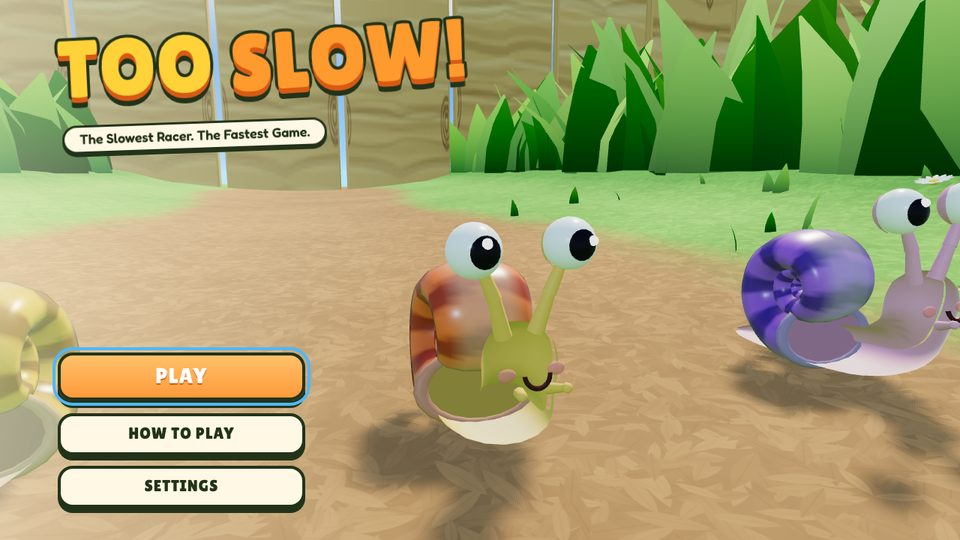

| The Backyard | Veggie Patch |
| --- | --- |
|  | 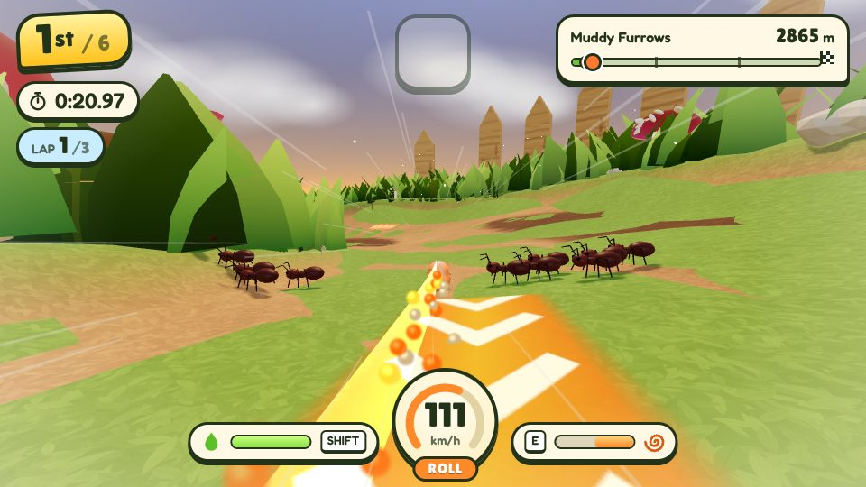 |
| **Lily Pond** | **Sandbox Canyon** |
|  |  |
| **Frosty Morning** | **Glow Grove** |
|  | 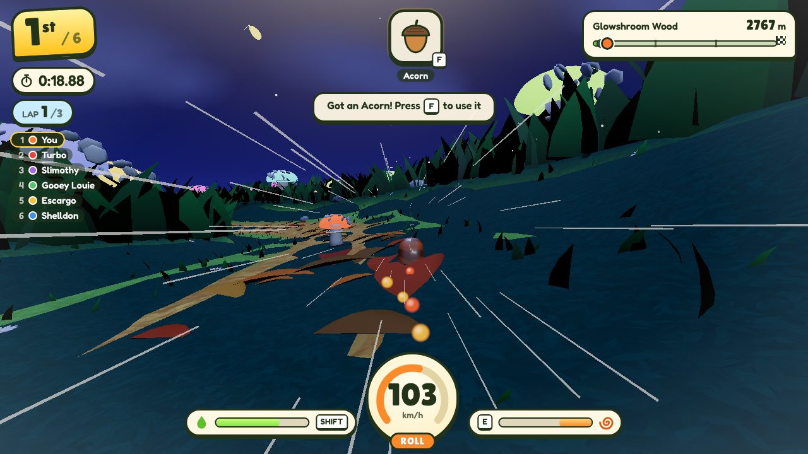 |
| **Boing Mushroom throw** | **Game modes** |
| 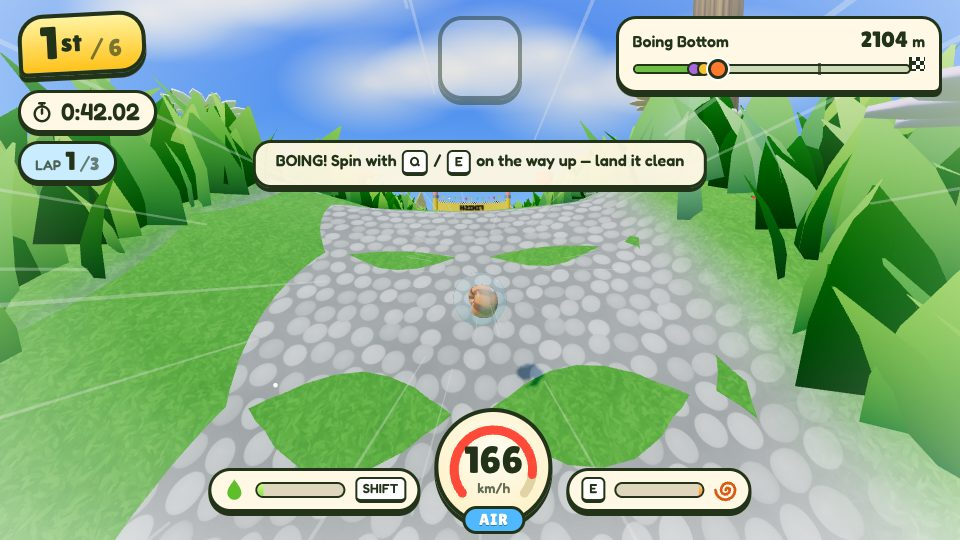 | 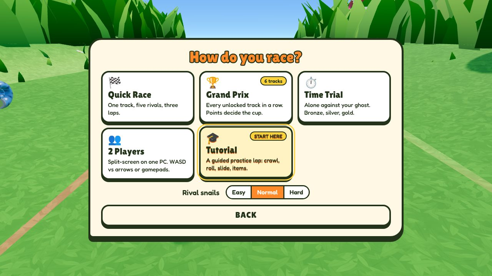 |
| **2 Players split-screen** | **Time Trial ghost** |
| 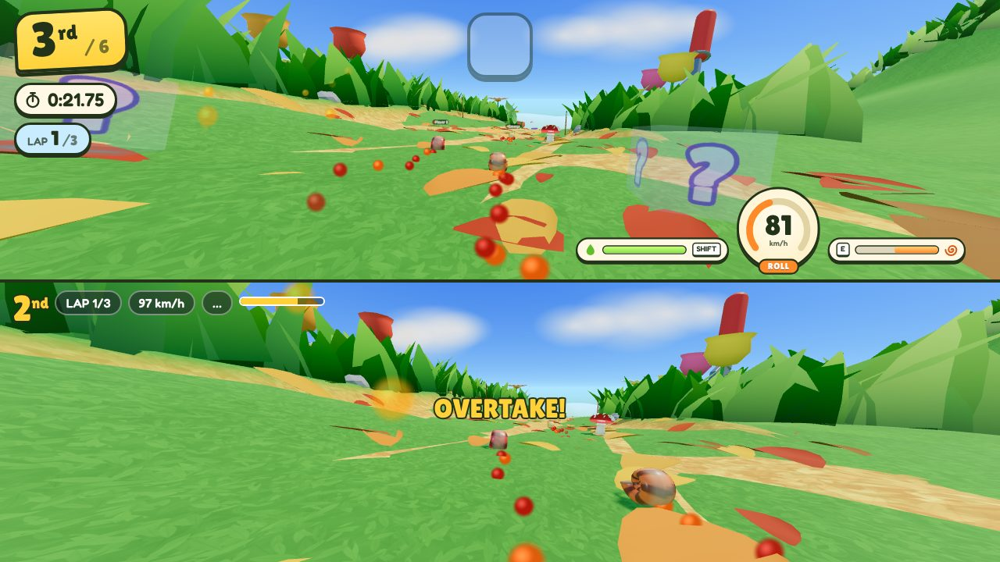 | 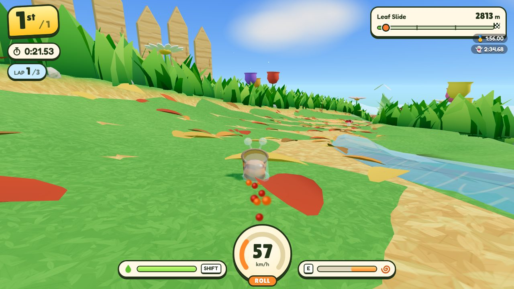 |
| **Grand Prix podium** | **Customize** |
| 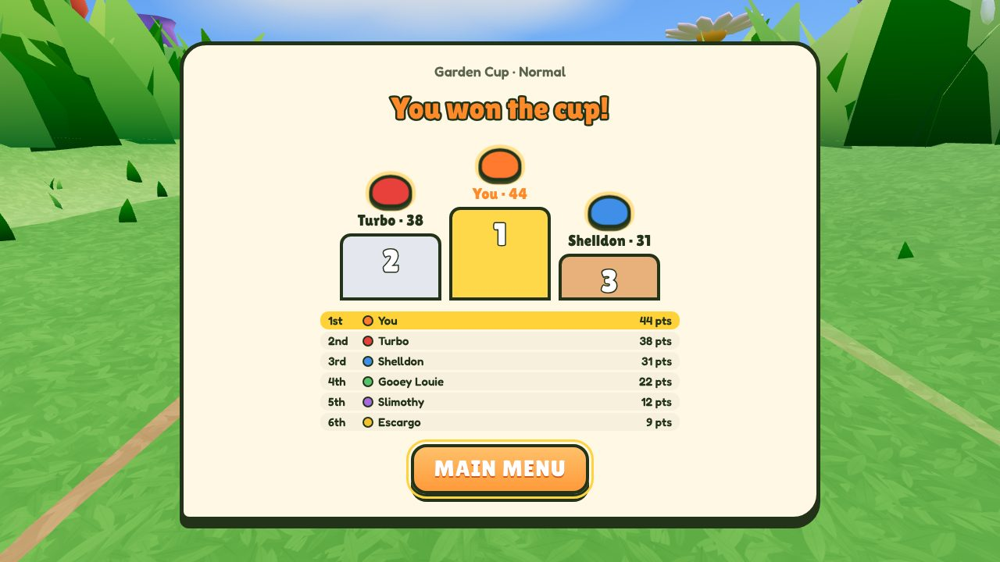 | 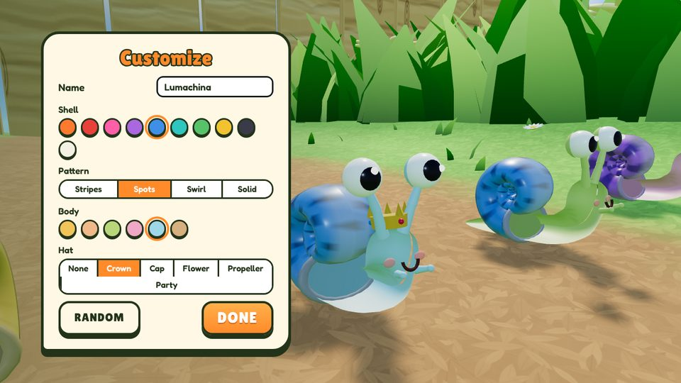 |
| **The Greenhouse** | **Rain mid-race** |
| 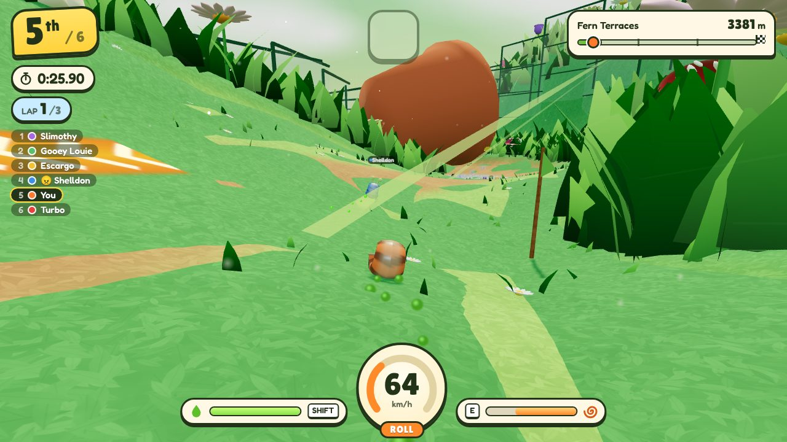 | 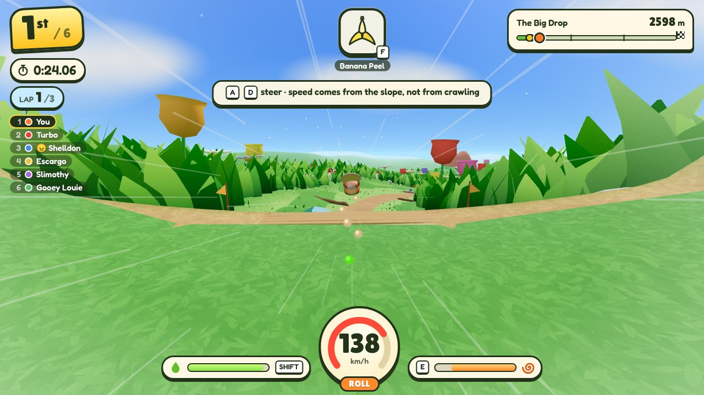 |
| **New items** | **Achievements** |
| 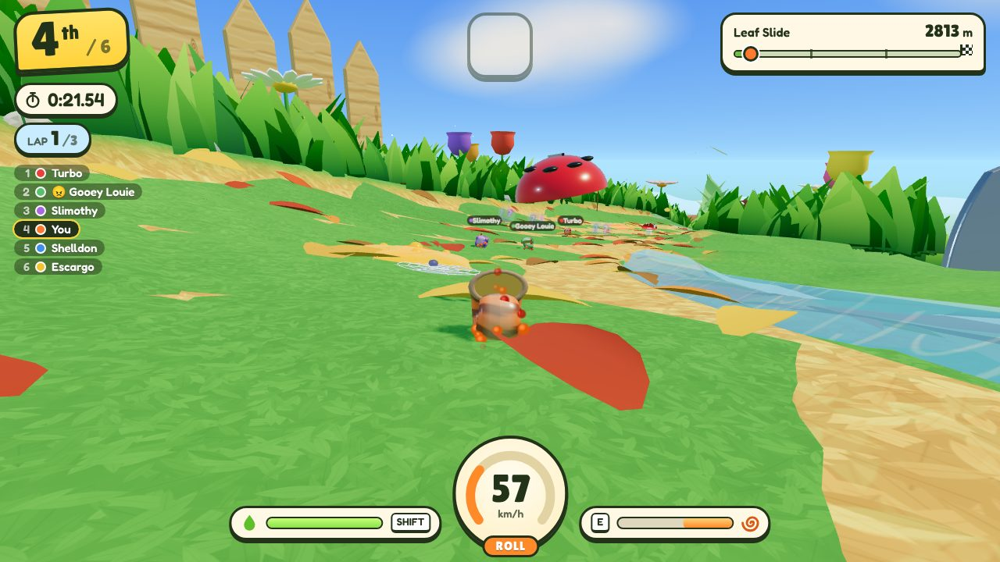 | 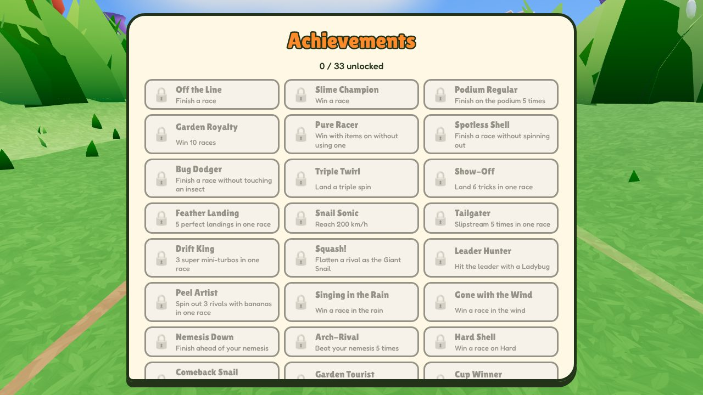 |

## Run it

```bash
npm install
```

```bash
npm run dev
```

Then open http://127.0.0.1:5188.

Production build (static files in `dist/`, relative asset paths, no server-side code):

```bash
npm run build
```

```bash
npm run preview
```

## Controls

| Key | Crawl | Roll | Air |
| --- | --- | --- | --- |
| `W` | crawl forward | — (no thrust while rolling) | — |
| `S` | slow / reverse | drag the shell to brake | — |
| `A` `D` | turn | steer (wider at speed) | nudge left / right |
| `SPACE` | tuck into shell | pop out (on the ground) | tuck in |
| `SHIFT` (hold) | slime slide | slime slide | — |
| `E` | — | shell boost when charged | spin right |
| `Q` | — | — | spin left |
| `F` | use item | use item | use item |
| `R` | back to last checkpoint | | |
| `ESC` | pause | `M` mute | |

Arrow keys mirror `WASD`. `F3` shows a frame-rate overlay.

**Gamepad** (standard mapping): left stick / d-pad steer, `RT` crawl, `LT` brake, `A` shell,
`B` or `RB` slide, `X` boost (spin right in the air), `LB` spin left, `Y` item, `Back` checkpoint,
`Start` pause. The d-pad / stick and `A` / `B` also drive every menu.

**Touch**: on-screen buttons appear on touch screens — ◀ ▶ steer, SHELL, SLIDE (hold), BOOST,
ITEM, BRAKE; crawling forward is automatic.

**2 Players** (split-screen, top / bottom): player 1 uses `WASD`, `SPACE` shell, left `SHIFT` slide,
`Q` / `E`, `F` item. Player 2 uses the arrows, `ENTER` shell, right `SHIFT` (or numpad `0`) slide,
`,` / `.` spin and boost, `/` item. A single gamepad goes to player 2; with two pads each player
gets one.

## How it plays

- **Crawl** is slow (about 11 "km/h"), precise and grippy. It climbs gentle slopes, refills slime
  and is how you recover after a crash.
- **Roll** has no engine at all. Speed comes from slope and momentum; rolling resistance depends on
  the surface, steering is a sideways force that gets weaker relative to your speed, and hard
  cornering scrubs speed.
- **Slide** spends the slime meter for near-zero friction: it glides over grass and mud and carries
  momentum through shallow sections and long bends, with a wider turning circle and a drifting body.
- **Shell boost** charges from actual shell rotation at speed; `E` gives a short impulse and briefly
  lowers drag.
- **Tricks**: spin with `Q`/`E` in the air. Land a full rotation for points and boost charge; land
  mid-spin and you lose a quarter of your speed.
- **Surfaces**: stone is fastest, wet leaves are fast but slippery, wood is good for ramps, grass is
  steady, mud and water are slow, tall verge grass is very slow.
- **Boost pads**: glowing orange chevrons on the ground fire you forward in any mode.
- **Drift mini-turbo**: steer hard while sliding at speed; the sparks turn blue, then orange.
  Let go of `SHIFT` for a small or big mini-turbo.
- **Items**: roll through a `?` box and, after a short roulette, press `F`:
  - Turbo Mushroom — instant burst of speed.
  - Banana Peel — dropped behind you; whoever rolls over it spins out.
  - Acorn — rolls along the course at the snail ahead of you and knocks it into a spin.
  - Super Slime — five seconds of slide that costs no slime.
  - Shell Shield — a bubble that blocks the next banana or acorn.
  - Giant Snail — six seconds huge, heavy and immune; touch a rival and you flatten it.
  - Spider Web — dropped behind; whoever rolls into it is caught and slowed.
  - Ladybug — flies along the course after the leader and knocks it spinning.
  - Honey Drop — a sticky puddle behind you for fourteen seconds.

  Leaders mostly get bananas and shields, the back of the pack mostly mushrooms and acorns. The AI
  snails use the same boxes, items and rules. Items can be switched off in Settings.
- **Customize**: name, shell colour, shell pattern, body colour and hat; saved in the browser.
- Leave the course for 2.5 s (or press `R`) and you return to the last checkpoint.

### Laps and the Boing Mushroom

Every race is three laps of a closed circuit. A lap starts on a flat plateau, runs downhill through
the course, and ends at the bottom on a giant red mushroom cap that bounces everyone 70–100 m back
up onto the plateau — three and a half seconds of flight in which `Q` / `E` spins score tricks
(land straight or lose speed). The finish line is on the plateau, just after the landing. A lap
only counts once every checkpoint of it has been passed, so cutting across the infield gains nothing.

### Modes

- **Quick Race** — one track, five rivals, three laps.
- **Grand Prix** — every unlocked track in a row (opens once three tracks are unlocked); 10-8-6-4-2-1 points per race, a podium at the end and a
  trophy per difficulty.
- **Time Trial** — alone, no items, against a see-through ghost of your personal best. Bronze,
  silver and gold target times per track.
- **2 Players** — split-screen against each other and four rivals.
- **Daily Challenge** — the same track, twist (rain, gale, only bananas, only Giant Snails, only
  Ladybugs, or Hard rivals) and race seed for everyone each day; top three clears it, streaks count.
- **Tutorial** — a guided practice lap with a checklist that ticks itself off: crawl, shell, steer,
  slide, item, boost, spin. Recommended on the first run.
- **Rival snails**: Easy / Normal / Hard changes how bravely and precisely the AI drives — the AI
  never gets extra speed.
- **Slipstream**: roll close behind another snail to halve your air drag and charge boost faster.
- **Weather**: garden tracks can cloud over mid-race — rain makes every surface slicker; open tracks
  get gusty wind that pushes you in the air (an arrow on screen shows where it blows).
- **Rivals have personalities**: they chatter when they pass you, get passed or hit you, and each race
  one of them is your **nemesis** (whoever beat you last): it drives harder and aims its items at you.

### Unlocks

Finishing in the top three unlocks the next track. Hats (Chef, Viking, Wizard, Halo), shells (Gold,
Galaxy) and slime trails (Sky, Bubblegum, Gold, Rainbow) are earned by finishing the tutorial,
winning races, landing tricks, Time Trial medals and Grand Prix wins — the garage shows how to earn
each one. A local **Hall of Fame** keeps your five fastest finishes per track, and 33
**achievements** have their own screen.

### Languages

English, Italiano, Español, Français, Deutsch and Português — picked from the browser, changeable in
Settings (`?lang=it` etc. to force one). Hints and the tutorial name the controls of the device you
are using (keyboard, gamepad or touch).

### Tracks

Finish in the top three to unlock the next track. Personal bests are kept per track.

| # | Track | Look | What makes it different |
| --- | --- | --- | --- |
| 1 | The Backyard | sunny garden | long wet-leaf sweeper with a leaf-bridge shortcut, the Big Drop kicker, a root maze, a banked hairpin |
| 2 | Veggie Patch | golden hour | mud strips on alternate sides with pads on the clean line, a scarecrow chicane, boardwalk bridge, Pumpkin Plunge |
| 3 | Lily Pond | dusk, fireflies | two lily-pad shortcuts, the Frog Leap over the pond, a stone ribbon between mud flats |
| 4 | Sandbox Canyon | hot sandpit, dust | a packed-sand groove that wanders across loose sand (which eats speed), a cactus zigzag, the Spade Ramp |
| 5 | Frosty Morning | snowy dawn, snowfall | a fast, slippery ice line down the middle, grippy slow snow either side, icicles and a glare-ice pond |
| 6 | Glow Grove | midnight, glowing mushrooms, bloom | a long left-hander through glowshrooms, S-bends on a stone ribbon, the Moon Jump over a moon-pool, Glow-worm Gully |
| 7 | The Greenhouse | warm mist under glass walls | a long fern-terrace U-turn, a seed-tray slalom, sprinkler puddles, the Watering Can Leap |

### Insects

- On the course: ant columns marching across (they scatter as you come through; bump one and you
  stumble), woodlice rolling side to side, rhino beetles wandering about on walking legs and
  grasshoppers hopping across. Beetles, woodlice and
  grasshoppers knock you into a spin; a Shell Shield blocks one. The AI reads where they will be and
  steers round them.
- Around the course: bees, dragonflies (most over the pond), ladybugs, butterflies and, at the pond,
  fireflies.

## Project layout

```text
src/
  main.ts                 boot, font loading
  game/Game.ts            state machine, fixed-step loop, events → VFX / audio / HUD, test hooks
  world/Track.ts          course engine: height, surface, obstacles, AI gates, pads, item rows as functions of (s, d)
  world/tracks/           the seven circuit definitions (shape, profile, theme, features)
  world/Terrain.ts        ribbon terrain mesh + water, generated from Track
  world/Backyard.ts       procedural prop kit (grass, flowers, mushrooms, roots, bridge, tools …)
  world/Environment.ts    sky, lights, shadows, fog, view distance
  world/Textures.ts       canvas-generated textures
  physics/RacerBody.ts    crawl / roll / slide / air physics, collisions (shared by player and AI)
  racing/RaceManager.ts   grid, countdown, checkpoints, placement, finish (DOM-free)
  racing/Items.ts         item boxes, roulette, bananas, acorns, hits (DOM-free, seeded)
  racing/Critters.ts      insect hazards, moving as a pure function of race time
  characters/Insects.ts   procedural insect models
  fx/CritterView.ts       insect hazards and ambient bugs on screen
  fx/Weather.ts           snowfall and drifting dust
  ai/SnailAI.ts           racing-line AI + the six racer profiles
  characters/SnailModel.ts procedural snail and its animation
  camera/FollowCamera.ts  speed-adaptive chase camera
  fx/Effects.ts           pooled particles, slime / boost ribbons, speed streaks
  fx/ItemView.ts          item boxes, banana peels and acorns on screen
  audio/AudioManager.ts   fully synthesised SFX, music and ambience (Web Audio)
  ui/Hud.ts, ui/Menus.ts  HUD, menus, settings and best-time storage
  ui/Hud2.ts              player-two HUD for split-screen
  ui/Progress.ts          medals, ghosts, trophies, stats, cosmetic unlocks, Hall of Fame
  game/GhostRunner.ts     time-trial ghost recording and playback
  game/Tutorial.ts        the guided practice-lap checklist
  core/Input.ts           keyboard (1–2 players), gamepads, touch buttons, gamepad menu cursor
  core/Platform.ts        CrazyGames SDK wrapper (gameplay events, midgame / rewarded ads)
  i18n/                   language switching; strings.ts is generated by scripts/i18n/build.py
  ui/Achievements.ts      achievements and the daily challenge
  racing/Personality*.ts  rival chatter in six languages, the nemesis
scripts/sim.ts            headless race simulation (track + physics + AI, no rendering)
tests/                    Playwright smoke test and keyboard-only full-race bot
```

### Physics

A custom arcade model rather than a general rigid-body engine: each racer is a sphere on an analytic
height field, stepped at a fixed 120 Hz with render interpolation. The course is defined as
functions, so ground contact is exact (no tunnelling at 200 "km/h", no ghost collisions on mesh
edges) and the same data drives physics, rendering, AI and race rules. Each circuit is a closed
centripetal Catmull-Rom spline; between the parts of the loop the terrain is an inverse-distance
blend of the centre-line heights, so the course sits in a believable hillside. Rapier was considered; for a
ball-on-terrain racer whose feel depends on hand-tuned friction, grip and steering, the analytic
model gave tighter control and a far smaller download.

### AI

The five rivals use the same `RacerBody` and the same `Intent` inputs as the player — they only
decide steering, shell, slide, brake and boost. They follow a look-ahead racing line through gate
windows, choose between routes per race, avoid obstacles and each other, brake for bends they
cannot make, and recover from crashes by crawling out. There is no rubber-banding and no position
faking: placement is each snail's real progress and real finishing order.

## Useful commands

Headless tuning run (prints section splits and every racer's result):

```bash
npm run sim -- 1 10
```

Add `--track=veggie`, `--track=pond`, `--track=sandbox`, `--track=frost` or `--track=glow` or `--track=greenhouse` for the
other circuits, `--weather=rain|wind|clear`, `--no-items` for a clean race, `--diff=0|2` for easy / hard rivals and `--mode=tt`
for a solo time-trial run.

Real-input smoke test and full-race bot (set `PLAYWRIGHT_CHROMIUM_PATH` to reuse an installed
Chromium):

```bash
npm test
```

The full-race bot takes about ten minutes on a machine without a GPU. What was run and observed for
this revision is recorded in [docs/VERIFICATION.md](docs/VERIFICATION.md); the design brief, core
loop and level plan are in [docs/DESIGN.md](docs/DESIGN.md).

URL overrides: `?q=-1` … `?q=2` (graphics, -1 = Mobile), `?dpr=0.5` (render scale), `?unlock=all` (open every track
and cosmetic for testing) and `?crazygames=1` / `?crazygames=0` (force the platform SDK on / off).

**Performance:** `F3` shows fps, frame time, draw calls and triangles. With *Auto graphics* on
(Settings, default) the game lowers render scale, shadows and view distance in steps if a race
runs below ~38 fps for a few seconds. Phones and tablets start on the **Mobile** graphics tier (sparser grass,
no shadows, lower resolution) with the touch HUD laid out between the buttons.

## Publishing notes (CrazyGames)

The build is fully static with relative paths. `src/core/Platform.ts` wraps the CrazyGames HTML5
SDK v3: the SDK script is loaded **only** when the game runs on a CrazyGames domain (or with
`?crazygames=1`), so the standalone build makes no external requests. Wired in:

- `loadingStart` / `loadingStop` around boot, `gameplayStart` / `gameplayStop` whenever a race is
  running or stops (pause, results, menus), `happytime` on wins and records.
- A midgame ad between races (never mid-race, at most every three minutes); audio is muted and the
  game holds while it shows.
- A rewarded ad on the results screen: watch it and the next race starts with a Turbo Mushroom.
  Without the SDK the button is hidden — there are no fake ads.

Online leaderboards need a platform account system or a backend; the game keeps a local Hall of
Fame per track instead. Promo art is in `promo/`: cover 1920×1080 and 800×1200, thumbnail 800×450,
icon 512×512, two extra screenshots and a short Boing Mushroom clip (`promo/boing-clip.mp4`).

## Credits and licences

- Code, models, textures, music and sound effects: original, generated procedurally at runtime.
- [three.js](https://threejs.org/) — MIT.
- Fonts bundled via Fontsource: [Lilita One](https://fonts.google.com/specimen/Lilita+One) and
  [Fredoka](https://fonts.google.com/specimen/Fredoka), both SIL Open Font License 1.1.
